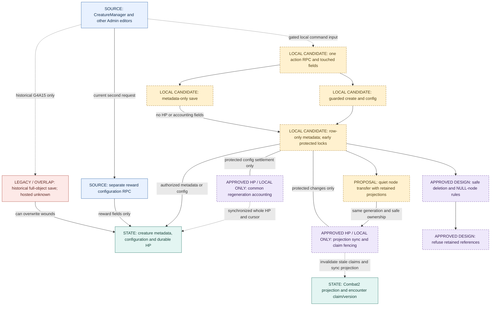

# Creature Admin authority contract and write flow

**G4A19: local candidate/client code, activation OFF; not installed.** Owner approves simplified replay and4-second regeneration. Read the [canonical rules](../design/game-engine.md), [implementation/handoff](../operations/legacy-001G4A19-simplified-admin-implementation.md) and [legend](README.md). Amber candidate nodes below have local code/tests, not deployed authority. Historical raw-save control is retained as evidence, not the current browser path.

## Current source and ownership

| Path | Boundary / evidence |
|---|---|
| [CreatureManager](../../src/components/admin/CreatureManager.tsx) | Dirty config-only save/create/delete via gated transport; immutable in-panel create intent, server refresh and separate unchanged reward RPC. No direct table mutation. |
| [NodeEditorPanel](../../src/components/admin/NodeEditorPanel.tsx) | Gated absolute move/unassign; no raw node writes. |
| [PopulatePanel](../../src/components/admin/PopulatePanel.tsx) | Stable per-proposal UUID, per-row results; unsupported legacy rewards refuse, never silently translate. |
| [Legacy loot editor](../../src/components/admin/loot/CreatureLootModesTab.tsx) | Unsupported single/bulk mode mutations refuse without writes. |
| [Transport](../../src/components/admin/creature-admin.ts) | Activation false; no fallback; typed matching outcomes, dirty config helpers. Read HP from server, formula display is a preview. |
| [SQL candidate](../operations/legacy-001G4A19-admin-candidate.sql) | One Admin action RPC; private coverage/accounting/reference helpers, no authoring ledger. Prepared table/column browser DML containment, owner/internal rights preserved. |
| [G4A15 harness extension](../../scripts/proofs/g4a15/admin-boundary.test.mjs) | Complete candidate bodies in private schema; real role helpers and selected commit/reward source, deterministic Auth/clock adapters and reduced schema. Not installed or full hosted parity. |

Metadata locks the creature row only and touches no HP/accounting fields. Protected commands discover coverage then sorted node gates → party lifecycle → sorted encounters → dependent projections/creature → revalidation. Creation uses its stable-identity mutex before coverage; other branches never acquire it later. Existing reward request/reward-key-before-row order remains separate, not nested inside Admin coverage. No late node-lock trigger.

Protected edits with retained projections return integration_required; active/blocking state refuses. Deletion/unassignment refuses retained references. Rich changed boss-cast documents return unsupported_boss until real catalogue-validator parity is integrated. Safe-ended projection transfer remains approved target, not implemented success. Legacy independent healers and full engine transition integration remain blockers. Metadata row-only trigger composition still needs fresh installed parity; bounded local waits do not prove global deadlock freedom.

Simplified replay: absolute config no-op/stale comparison, stable creation UUID/manual uncertainty reconciliation, already_absent deletion without historical claim. No new authoring receipt or TTL. Existing reward ledger/contract is unchanged. G4A17's eight interface/receipt/five-slice proposal is historical, superseded by approved G4A18/G4A19. All previous OPEN/BLOCKED/deferred findings remain; see the report for cutover gates.
