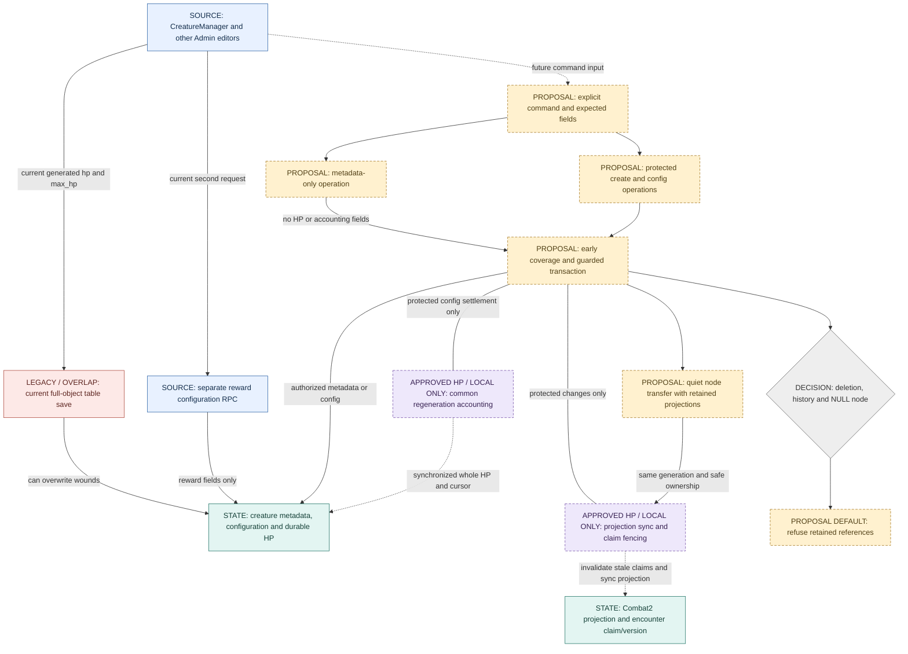

# Creature Admin authority contract and write flow

**G4A16 design proposal; no new API is implemented, installed or approved as policy.** The HP rules below are already owner-approved; the API grouping, conflict handling, receipt storage and A–D decisions remain recommendations. Read the [legend](README.md#diagram-legend-and-evidence-rules), [system map](wov-ownership.md), [G4A15 evidence](../operations/legacy-001G4A15-creature-admin-configuration-integration.md) and [ordered readiness checklist](creature-hp-readiness.md).

No future arrow is a deployed route. Existing reward RPC remains a separate request in this diagram; D below asks whether that should change. FENCE represents encounter/projection dependencies, not an extra HP authority. No late-locking row trigger is proposed.

## Current entry points and major edge references

| Diagram / entry | Current writer and affected fields | Transaction/owner and evidence |
|---|---|---|
| UI → RAW: [CreatureManager](../../src/components/admin/CreatureManager.tsx), handleSave249–340 | Direct creatures INSERT/UPDATE: name, description, node, level/rarity, **hp/max_hp**, stats/AC, aggression/base aggression, humanoid flag, respawn seconds and boss flavor/cast fields. Creation supplies permanent UUID. | One table request, followed by reward RPC. Intended content owner is Admin; current generic save also writes combat HP. G4A15 locally demonstrates healing/projection divergence; fresh hosted source/ACL parity unknown. |
| UI → CHOICE: same handleDelete344–350 | Direct creature DELETE; actual FK cascades/history impact need installed evidence. | Separate table request, not a guarded lifecycle protocol. Local conservative refusal is not installed protection. |
| UI → NODE: [NodeEditorPanel](../../src/components/admin/NodeEditorPanel.tsx), assign/unassign737–760 | Direct node_id target or NULL; no HP synchronization/claim fence in the caller. | One request each. G4A15 runs full handlers through a private guard, not a deployed replacement. |
| UI → CONFIG: [PopulatePanel](../../src/components/admin/PopulatePanel.tsx), applyAll104–145 | Loop of direct full-HP creations with generated stats/AC, node, loot/gold legacy configuration. | Each insert is independent. Source inspected, not reproduced as a supported guarded bulk transaction. AI output is a proposal, not an authorized database writer. |
| UI → REWARD: [CreatureLootModesTab](../../src/components/admin/loot/CreatureLootModesTab.tsx), saveAll/bulkSetMode66–88 | Direct loot_mode single/bulk update. | Separate legacy configuration route; not automatically equivalent to the canonical reward RPC. Requires mapping, not silent translation. |
| REWARD → HP configuration: [admin_set_creature_rewards](../../supabase/migrations/20260915200000_combat2_authoritative_reward_channels.sql),78–111 | gold enabled/range/chance, salvage enabled, item source, loot table/drop chance and unique item/chance. Complete reward validator53–63. No HP/accounting writes. | Source auth/role check, expected config, UUID request receipt, request/creature advisory locks then creature row. G4A15 executes ordinary branch. Current installed body/ACL and unique/full constraint graph not freshly verified. |
| INPUT / META / CONFIG / LOCK / ACCOUNT / FENCE / PROJ / NODE | [G4A15 private guards](../../scripts/proofs/g4a15/adapters.sql), [G4A7 wrappers](../../scripts/proofs/g4a7/adapters.sql), [G4A13 coverage](../../scripts/proofs/g4a13/adapters.sql), [approved transition design](../operations/legacy-001G4A5-creature-hp-transition-integration.md); proposed envelope/operations below | Local-only tested dependencies and proposed production-facing contract.25 native G4A15 tests/8 observed session cases are reused evidence; neither installable production SQL nor comprehensive global deadlock proof. |
| CHOICE / RETAIN | Owner decision table B/C below; [G4A15 retained-reference refusal](../operations/legacy-001G4A15-creature-admin-configuration-integration.md) | Conservative local refusal exists; adopting that policy for production deletion/unassignment awaits owner approval. |
| Other writers → HP | [G4 inventory](../operations/legacy-001G4-creature-authority-lifecycle.md), [G4A legacy regeneration/wake](../operations/legacy-001G4A-regeneration-hp-ownership.md), [G3E](../operations/legacy-001G3E-owner-disposition-g4-handoff.md) | Canonical commit and ordinary respawn are legitimate lifecycle owners; legacy regen/wake healing, Arena reset and retained restricted damage/heal/delegation remain separate authorities/unknown reachability. Generic privileged DML is not a supported replacement for these operations. |

Source Admin role intent is [is_steward_or_overlord and creature policies](../../supabase/migrations/20260215091228_fce1ea0c-a649-4361-959e-c677e1011267.sql). Keep the same authorization requirement; do not infer that current RLS/grants exclude every other retained writer. The source map is reused evidence, not a new broad privilege audit.

## Proposed common command envelope

Names below are **logical operations**, not existing SQL signatures or granted browser RPCs. Prefer one narrow database transaction per accepted command; transport choice must preserve server-side authorization and atomic state validation. No new Edge service is required by this design.

- Identity: authenticated actor from trusted request context, operation, creature UUID, request UUID for consequential mutations, contract version1, explicit payload and operation-scoped expected fields. Never accept actor/role as browser authority. Reject unknown/duplicate/ill-typed fields; normalize missing versus NULL explicitly. Creation uses a stable preallocated creature UUID across retries.
- Server field ownership: browser may choose permitted content inputs, **never current hp, is_alive, spawn_seq, died_at, Combat2 HP, encounter state/version/claim, accounting cursor, eligibility or fractional credit**. MaxHP and rate are authorized configuration inputs, not direct HP setters. Generic full-object PATCH is not the new API.
- Authorization: existing nonnull actor plus Steward/Overlord check on every command, with no privilege expansion. Raw service/owner writers are not implicitly approved callers; inventory/Combat2/respawn internal paths keep their distinct authority. No new mandatory reason or second-person approval is invented for ordinary authoring.
- Expected state recommendation A: compare only relevant authored fields under locks, using a canonical expected object from the server's edit read. Metadata uses name/description; protected operations additionally bind generation/node and affected config. Do not use hp, accounting time or encounter state_version as an Admin form revision: ordinary combat must not stale an otherwise unchanged metadata form. Do not assume creatures.updated_at or a dedicated authoring-version column exists. A future revision column is optional, not a requirement or authorized migration.
- Success: `{ok:true, kind:committed|replayed|already_matches, requestId, creatureId, operation, appliedConfig, refreshRequired:true}`. Return authoritative changed/read fields, not browser-calculated HP success. Report committed success only after the transaction, including deferred constraints, commits; an inner function result alone is insufficient. `already_matches` describes current config only, never original-request provenance. Deletion may return a minimal tombstone outcome only if policy B permits it. This is a proposed envelope, not the current reward RPC response.
- Refusal/conflict: `{ok:false, kind:not_authorized|invalid_input|not_found|stale_config|combat_active|not_quiescent|retained_references|request_conflict|retry_required, requestId, committed:false}` only when the transaction definitively did not commit. Limit returned conflict fields to authorized content; no unrelated player data. Unknown transport outcome is **not** a definitive refusal.
- Retry: preserve UUID, immutable payload and expected object on timeout/ambiguous failure; explicit retry, no automatic replacement. For receipted operations, matching committed receipt returns original outcome and conflicting UUID reuse refuses. A no-receipt `already_matches` comparison is not proof the original request committed and cannot promise UUID conflict detection. Changed payload after a definitive conflict/refusal is a new request. If rediscovery changes coverage, rollback the whole attempted command and return retry_required; no late node lock. An authorized side-effect-free receipt lookup may resolve a successful deletion retry before requiring a live creature row; new/unresolved requests must lock and recheck before effects. Deletion must not cascade away its promised replay result. Exact storage/retention remains a review gate.
- Receipt recommendation: reuse the existing reward request store **only for its existing reward operation**. New consequential authoring operations need a minimal bounded creature-authoring receipt if exact replay is promised, using the existing request/actor/target/arguments/result pattern. Do not put creature commands into a character-specific inventory/progression ledger or invent a general audit/replay framework. Storage/retention/replay after deletion must be reviewed before implementation; this document approves no table or retention policy. Metadata may use scoped expected-state conflict handling without a durable receipt if exact historical replay is explicitly not promised. This narrower option must be made explicit in the final API.

## Per-operation contract

All operations inherit authorization, validation, output/refusal and retry rules above. Each successful mutation and its required receipt/synchronization is one transaction; partial accounting or a receipt without its mutation is forbidden.

| Logical operation | Inputs / expected state | Server-owned effects and locking / rejection |
|---|---|---|
| `metadata.edit` | creatureId; patch containing only name/description; expected values for touched fields. Nonempty name. | Early covered transaction; update metadata only. May coexist with active combat; no HP settle, formula derivation or claim invalidation merely for prose. Stale field → conflict A, not full-object overwrite. Replay promise explicitly selected as above. |
| `creature.create` | stable creatureId/requestId; name/description; node or NULL; level/rarity, current supported authored config. No hp/current-state fields. Expected identity absent; authorized node/config references. | Server derives initial HP/maxHP, stats and AC from the existing [generation formula](../../src/shared/formulas/creatures.ts), initializes alive/generation/accounting with no historical credit. Default rate5% is the approved provisional default, not a new universal balance rule. SQL/server formula parity must be established, not guessed. Same request cannot create twice; conflicting existing identity refuses. Active-node/absent-encounter creation policy remains conservative until covered source integration permits it; do not claim G4A15 supports all nodes. Default reward config first; later reward request is separate under D recommendation. |
| `config.edit` | explicit allowlist: level/rarity, aggression/base aggression, humanoid flag, respawn settings and validated boss config; expected affected config plus generation/node. | Server uses current canonical formula and boss validation, not client stats/AC. A level/rarity change that changes maxHP invokes the same missing-HP-preserving max operation in the **same** transaction. Refuse active attachment/blockers pending covered policy; no HP refill or generation revival. Text that encodes damage/type/timing is protected config, not metadata. No new stat override input or naming redesign. |
| `maximum.edit` | positive bounded integer maxHP; expected maxHP, generation and node. | Settle eligible old maximum first; keep absolute missingHP, living floor1, dead HP0/dead generation. Synchronize current projection and fence affected claims/version. Refuse active attachment or live claim; no resource/reward change. A create/config command may delegate internally without creating a second writer. |
| `regeneration.edit` | decimal percentage text0–100 inclusive, at most two decimal places; expected rate/generation/node. | Common accounting settles old rate, applies whole HP, discards fractional remainder, starts new accounting cursor, **preserves uninterrupted eligible_since and original60-second delay**.0 disables only ordinary regeneration. Dead creature does not regenerate. Refuse active attachment/live claim; synchronize/fence even when only rate changed. Replaying must not repeat fraction discard at a later time. |
| `node.reassign` | explicit nonnull destination; expected origin/generation and relevant node config. | Discover source/destination and all retained references first. Require safe-ended source/destination, no relevant effects, pending actions/intents/events or uncleared claims; held locks prevent new cooperative entry invalidating the check. Settle old eligible time, transfer current-generation projection ownership, keep HP/generation, invalidate both affected encounter claims/versions. Historical generations are not silently moved or deleted. Missing destination encounter requires an explicit covered path, not late creation under dependent locks. |
| `node.unassign` | NULL destination only through explicit operation; expected origin/generation. | Decision C pending. Recommended initial support only for unprojected, unreferenced, quiet creatures: settle old eligible time, atomically set node NULL and preserve wounds/accounting. Refuse retained projections/claims/effects/history instead of silently deleting them. Quarantine/archival semantics are not invented. |
| `creature.delete` | target/request; expected identity/generation/node. | Decision B pending. Recommended initial hard delete only when all relevant references are absent, verified under coverage/constraints. Retained combat/reward/legacy/unique/contract references refuse. Preserve a minimal request result for exact retry only if receipt policy is approved. No cascading history purge, new archive flag or reuse of deleted identity without a separate lifecycle contract. |
| `rewards.edit` | Existing exact signature and `_expected`, `_desired`, `_request_id`; do not silently change JSONB response. Caller translates current result contract explicitly if a unified command envelope is later approved. | Existing body/validator remains reward authority. Future integration needs early affected-node/encounter coverage and claim/config fencing around changed combat reward input, preserving source request/reward advisory→row order. Exact replay comes from existing request ledger. Do not nest it after a generic save already holds the creature row. Under D default it remains a separate transaction with clear partial-save feedback. Legacy loot_mode cannot be assumed equivalent; map/refuse it before any editor cutover. |

Configuration limits not already established by source/approved HP policy remain validation-design work; this contract does not invent level caps, respawn balance, new reward values or a new regeneration formula. UI maxHP/rate previews must be derived/read-only presentations until the authorized server returns committed state.

## Lock and transaction composition

Required order: **discover all source/destination nodes, references and operation coverage → sorted node gates → party lifecycle → sorted existing encounters → operation/request advisory keys where required → sorted dependent projection/creature rows → revalidate → compare expected config → settle/mutate/synchronize/receipt → commit**. No new node lock after lifecycle/dependent locks. Existing helpers may only reacquire already-covered locks; a source definition introducing a new outgoing lock requires review before composition.

The existing reward RPC takes `admin-creature-reward-request` then `admin-creature-reward` advisory keys **before** its creature row. A future wrapper must reserve those keys before dependent rows, then call the body reentrantly. G4A15.cover already takes dependent rows and is **not** a drop-in outer wrapper for this RPC. Keep raw source callers separate until their order is reconciled; otherwise row→request versus request→row can deadlock. No final SQL design or global deadlock-freedom claim is made here.

Expected-config comparison is not the same as lock coverage revalidation. The former detects stale content intent; the latter prevents late nodes/generations/encounters from entering a transaction. Both must precede effects. Concurrent respawn changes generation and must conflict/retry protected edits, while dead→alive remains ordinary respawn authority. Administrative metadata does not wake the world or advance encounter ticks. Browser refresh uses the committed server projection, never an optimistic heal.

## Owner decisions — recommendations only

| Decision | Recommended default and rationale | Consequences / migration implications | Approval |
|---|---|---|---|
| **A Stale forms** | Refuse conflicting operation-scoped authored fields, return current authorized config, require explicit reload/review/new request. Ignore unrelated HP/tick changes for metadata. | No last-write-wins overwrite or automatic merge of protected values. Can compare existing fields under lock without adding a revision column; receipt/optional revision schema is future reviewed work. | **PENDING** |
| **B Retained history deletion** | Refuse hard deletion when combat/reward/unique/contract/legacy references remain. Allow only proven unreferenced deletion initially. | Preserves evidence and ownership. No archive schema or cascade migration now. Archival/retirement may be a later explicit lifecycle task; do not silently convert deletion into soft archive. | **PENDING** |
| **C NULL node** | Support explicit safe unassignment only for quiet, unprojected/unreferenced creatures; refuse retained-state cases. | Preserves current simple content-authoring use where safe. No new column required for NULL itself; source validation/containment and reference coverage still need implementation. Broader retained unassignment needs an explicit design. | **PENDING** |
| **D Save + rewards** | Keep separate explicit operations initially; display which operation committed and which refused. | Smallest change; avoids request-lock inversion and reward redesign. Existing partial save remains visible. No combined migration now. Atomic composite is optional later, requiring shared early lock/request order and rollback/receipt tests; not nested calls after row locks. | **PENDING** |

These recommendations do not expand existing owner acceptance of limitations into new policy approval. Approving A–D would still not authorize SQL, UI, privilege or hosted changes. See the [next decision/implementation gates](creature-hp-readiness.md).
