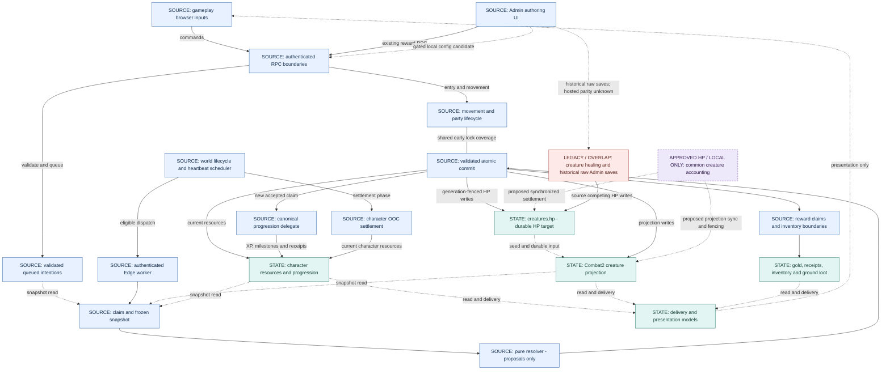

# WoV system ownership overview

Read with the [legend](README.md#diagram-legend-and-evidence-rules). This is the intended ownership structure overlaid with relevant current source paths, not a claim that all writers are installed, exclusive or gameplay-verified. It reuses completed B–F/progression inventories without reopening them.

The browser submits intent; neither a browser state update nor the pure resolver commits gameplay. Claim leases, committed encounter ticks, global heartbeat identities, settlement buckets and command UUIDs are distinct fences. Immediate movement does not wait for a heartbeat. The diagram's shared line represents coordinated locking/transactions, not universal ownership by the scheduler. Future creature accounting is a common dependency of covered entry/claim/config/maintenance transactions, not a new independent timer or regeneration service.

## Traceability and evidence boundaries

| Nodes / edges | Source and authoritative references | Evidence boundary |
|---|---|---|
| UI → RPC; VIEW → UI | [GameRoute](../../src/pages/GameRoute.tsx), [GamePage](../../src/pages/GamePage.tsx), [engine authority](../design/game-engine.md#engine-principles-and-authority) | Input/presentation role; not proof every historical client mutation has been retired. |
| ADMIN → RPC/LEGACY | [CreatureManager](../../src/components/admin/CreatureManager.tsx), [G4A15 exact writer map](../operations/legacy-001G4A15-creature-admin-configuration-integration.md), [Admin flow](creature-admin-authority.md) | Existing full saves write generated HP; separate reward RPC. Source/current local reproduction, not hosted exploit evidence. |
| HB → EDGE/OOC | [heartbeat identity](../design/world-heartbeat-identity.md), [dispatch handler](../../supabase/functions/combat2-dispatch-once/handler.ts), [G3 lifecycle](../operations/legacy-001G3-world-lifecycle-scheduling.md) | Existing installed/deployed/bounded ordinary-window evidence is recorded in the heartbeat document. Actual current schedule/isolation and all failure branches are not freshly established here. |
| RPC → INTENT; EDGE → CLAIM → RESOLVE → COMMIT | [intent/hostile boundary](../../supabase/migrations/20260928100000_combat2_authoritative_arrival_hostile_initiation.sql), [worker](../../supabase/functions/_shared/combat2/process-node-tick-once.ts), [decoder](../../supabase/functions/_shared/combat2/decode.ts), [resolver](../../supabase/functions/_shared/combat2/resolver.ts), [full-source composition](../operations/legacy-001G4A12-full-claim-commit-integration.md) | Browser queues validated intent; it does not call the service-only claim/commit authority. Complete selected source and native execution, not deployed artifact parity or all encounter mechanics certification. |
| HP/PROJ → CLAIM; COMMIT → HP/PROJ | [current core0002](../../drizzle/migrations/0002_progression_001d_canonical_xp_cutover.sql), [G4 ownership gaps](../operations/legacy-001G4-creature-authority-lifecycle.md), [HP contract](../operations/legacy-001G4A3-creature-hp-contract-readiness.md) | Current source mirrors damage; **coherent durable authority across every writer is future integration**, not an installed guarantee. Source claim normally reads projection HP. |
| COMMIT → PROG → CHAR | [canonical repaired XP0004](../../drizzle/migrations/0004_progression_001e_r2_xp_body_repair.sql), [G4A14 real progression proof](../operations/legacy-001G4A14-canonical-reward-progression-integration.md), [progression disposition](../operations/legacy-001-progression-domain-disposition.md) | Canonical source/accepted earlier rollout evidence plus bounded local execution. Four progression limitations remain OPEN; not a new audit or hosted reward test. |
| MOVE — COMMIT | [G4A13 multi-node coverage](../operations/legacy-001G4A13-in-tick-departure-coverage.md), [Party F closeout](../operations/legacy-001F11-evidence-and-closure-assessment.md), [movement source](../../supabase/migrations/20260929100000_combat2_immediate_authoritative_departure.sql) | Shared node/lifecycle/encounter/dependent locks. Retained private queued-party completion remains unproven/unsupported in selected composition; no restoration implied. |
| COMMIT → REWARD → ITEMS | [core0002](../../drizzle/migrations/0002_progression_001d_canonical_xp_cutover.sql), [E13 disposition](../operations/legacy-001E13-economy-rewards-closeout.md), [D10 inventory closeout](../operations/legacy-001D10-closeout.md) | First reward claim gates canonical XP/additive gold/loot in selected core. Inventory/vendor/salvage/quest limitations are not resolved by this arrow. |
| OOC → CHAR | [OOC source](../../supabase/migrations/20260923100000_authoritative_ooc_resource_settlement.sql), [C2 lifecycle composition0013](../../drizzle/migrations/0013_progression_001g_c2_reset_and_cutover.sql) | Existing character settlement; do not substitute proposed elapsed creature regeneration for its distinct rules. |
| REGEN → HP/PROJ | [G4A5 integration design](../operations/legacy-001G4A5-creature-hp-transition-integration.md), [G4A6 accounting](../operations/legacy-001G4A6-local-creature-hp-candidate.md), [G4A15 tests](../operations/legacy-001G4A15-creature-admin-configuration-integration.md) | Approved60-second eligibility, configured rate and coherent HP direction, implemented only in local proofs. No independent new regeneration writer. |
| LEGACY → HP; world transitions | [G4A regeneration/wake analysis](../operations/legacy-001G4A-regeneration-hp-ownership.md), [G3E deferral](../operations/legacy-001G3E-owner-disposition-g4-handoff.md) | Competing source heal/Admin paths, restricted legacy callers and source-proven idle/activation race remain. G3 correction deferred; G3D BLOCKED. Empty active encounter alone is not a shutdown defect. |

Administrative XP grants remain paused. Normal gameplay XP earning is not intentionally disabled by that policy; Combat2 gameplay XP is not declared hosted-runtime-verified. E13 quest/contract completion, privileged delegation/external callers, accepted Combat1 risk and deferred F1 retry weakness remain outside this diagram's certification scope.

G4A17 owner approval now establishes scoped stale-field conflicts, retained-reference deletion refusal, limited safe NULL-node unassignment, separate save/reward transactions and durable consequential replay versus metadata-only comparison. These are [approved design rules](../design/game-engine.md#approved-creature-admin-contract--not-implemented), **not new source or installed paths**. Candidate RPC/containment work is [planned separately](../operations/legacy-001G4A17-admin-implementation-readiness.md); this source overview deliberately does not redraw future RPCs as current writers.

G4A19 adds gated local Admin configuration callers/candidate, not an installed RPC or engine HP cutover. [Current handoff](../operations/legacy-001G4A19-simplified-admin-implementation.md) records approved4-second accounting and simplified replay. Legacy independent healing remains an OPEN competitor.
